# Figures

<!-- Generated by `python -m ssemd docs` from data/; edit src/ssemd/report.py, not this file. -->

Main figures are in `figures/main/`, Extended Data in `figures/extended/`; each as PDF and SVG (editable text) and 600 dpi PNG. The values plotted in every panel are in `figures/source_data/<figure>_<panel>.csv`. Rebuild with `python -m ssemd figures`.

## Fig. 1. From 21,712 Materials Project entries to one class per composition

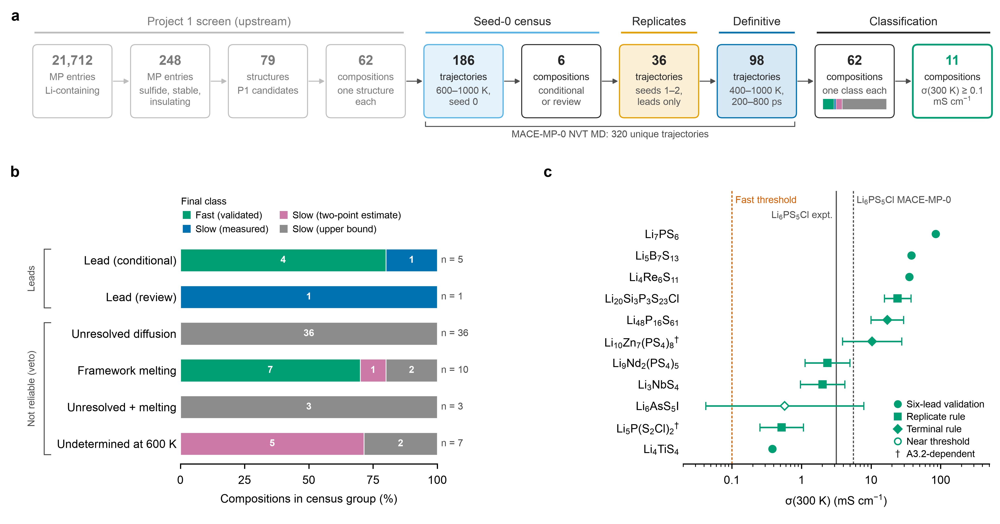

**a**, The pipeline from left to right. Grey boxes are the upstream Project 1 screen (21,712 Li-containing Materials Project entries, 248 after the property filters, 79 candidate structures, 62 compositions). Coloured boxes are the MACE-MP-0 NVT stages; tinted boxes count trajectories and white boxes count compositions: seed-0 census (186 trajectories, 600-1000 K), 6 leads, 36 replicate trajectories (MD seeds 1 and 2), 98 definitive trajectories (400-1000 K, 200-800 ps), 320 unique trajectories in all, ending in 62 classified compositions of which 11 are fast. **b**, Each seed-0 census group as a 100 % stacked bar with segments coloured by final class; seven of the ten compositions the census vetoed for framework melting end fast once every temperature is judged on its own. **c**, Predicted sigma(300 K) of the 11 FAST_VALIDATED compositions with pooled 95 % intervals where they exist; marker shape gives the deciding rule, an open marker means near the threshold and a dagger marks dependence on amendment A3.2. Reference lines: the 0.1 mS cm-1 threshold, Li6PS5Cl measured (3.15 mS cm-1, sintered) and the same potential's Li6PS5Cl prediction. Sources: data/workflow.csv, data/compositions.csv, data/classification.csv, data/references/li6ps5cl_calibration.csv.

## Fig. 2. Per-temperature evidence behind every class

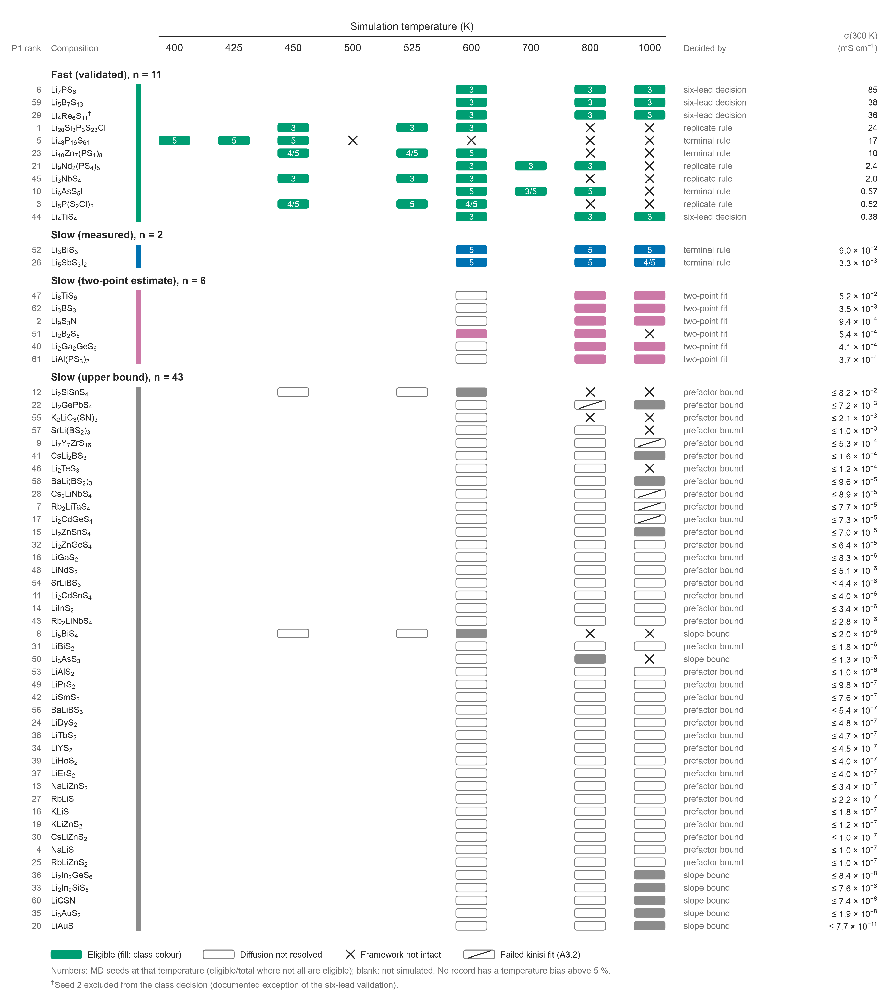

Rows are the 62 compositions (P1 rank at left), grouped by final class and sorted by sigma(300 K) within each class; columns are every simulated temperature. Each cell summarises all classifier records at that composition and temperature: filled in the class colour, at least one eligible run; open, diffusion not resolved; cross, framework not intact; slashed, failed kinisi fit (amendment A3.2); blank, not simulated. Numbers give MD seeds at that temperature (eligible/total where not all were eligible). No record exceeds the 5 % temperature-bias limit. The right-hand columns give the rule that decided the class and sigma(300 K) as an estimate or an upper bound. Double dagger: seed 2 of Li4Re6S11 is excluded by the documented exception of the six-lead decision. Sources: data/runs.csv, data/classification.csv.

## Fig. 3. Arrhenius behaviour of the eleven fast conductors

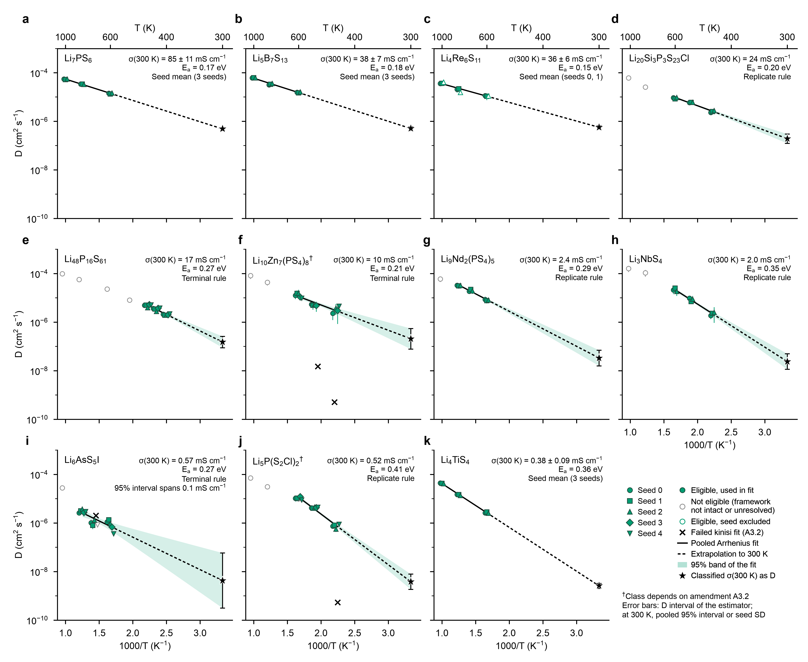

**a-k**, Li diffusion coefficient against 1000/T for every FAST_VALIDATED composition, ordered by sigma(300 K). Marker shape gives the MD seed (offset slightly per seed); filled markers are eligible runs used in the fit, open grey markers failed eligibility (framework not intact or diffusion not resolved), open green markers are eligible but excluded by the seeds-0/1 exception of Li4Re6S11, and crosses are failed kinisi fits (amendment A3.2) drawn at their kinisi D; error bars span the estimator interval. The black line is the pooled OLS Arrhenius fit (solid over the data, dashed to 300 K) with its 95 % band; the star is the classified sigma(300 K) expressed as D through the Nernst-Einstein factor, with the pooled 95 % interval or, for the four seed-mean leads, +-1 SD of the per-seed fits. Dagger: the class depends on amendment A3.2. Sources: data/runs.csv, data/classification.csv, data/replicates/lead_decisions.csv.

## Fig. 4. Room-temperature conductivity estimates and bounds for all 62 compositions

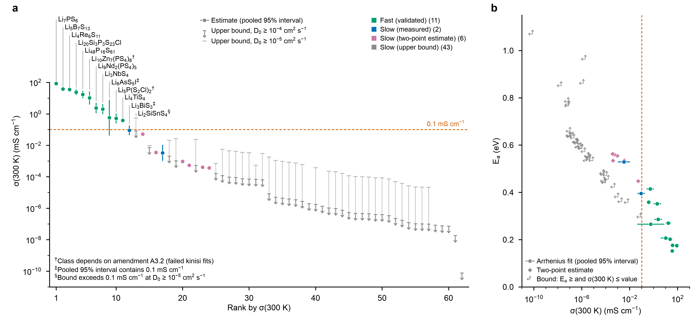

**a**, All 62 compositions ranked by sigma(300 K). Estimates are filled class-coloured markers with the pooled 95 % interval where one exists; upper bounds use an upper-limit symbol at the pre-registered prefactor D0 >= 1e-4 cm2 s-1, and a faint bar joined by a thin line marks the looser bound at D0 >= 1e-5 (two-point slope bounds do not assume D0). The dashed line is the 0.1 mS cm-1 threshold. Labelled: every composition above it, Li3BiS3 (double dagger, interval contains the threshold) and Li2SiSnS4 (section sign, bound exceeds the threshold at D0 >= 1e-5). **b**, Activation energy against sigma(300 K): circles are Arrhenius fits with the pooled interval, diamonds two-point estimates; for bounded compositions the corner symbol indicates Ea at least and sigma(300 K) at most the plotted value. Source: data/classification.csv.

## Fig. 5. Robustness of the classification

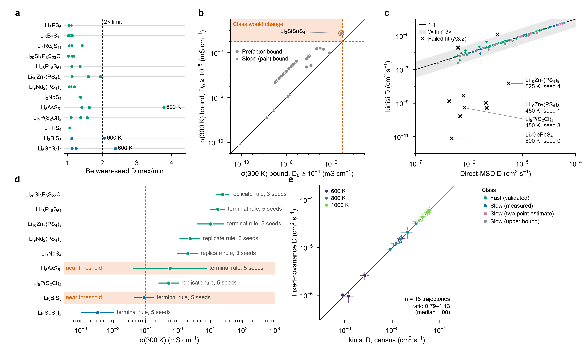

**a**, Between-seed D max/min at every composition and temperature with at least two eligible seeds, against the 2x replicate limit; ratios above the limit (all at 600 K) are labelled. **b**, The 43 upper bounds at D0 >= 1e-4 against D0 >= 1e-5 cm2 s-1; slope (pair) bounds do not depend on D0 and lie on y = x; only Li2SiSnS4 enters the region where its class would change. **c**, kinisi D against direct-MSD D for every kinisi record that meets the census eligibility criteria, with the 1:1 line and the 3x band of amendment A3.2; failed fits are crosses and those of the A3.2-dependent compositions are labelled. **d**, sigma(300 K) with its pooled 95 % interval for the nine compositions that have one, with the deciding rule and number of seeds; intervals containing 0.1 mS cm-1 are highlighted. **e**, Census kinisi D against fixed-covariance D for the same 18 seed-0 trajectories of the six leads, by temperature. Sources: data/runs.csv, data/classification.csv.

## Extended Data Fig. 1. Mean-squared displacement curves

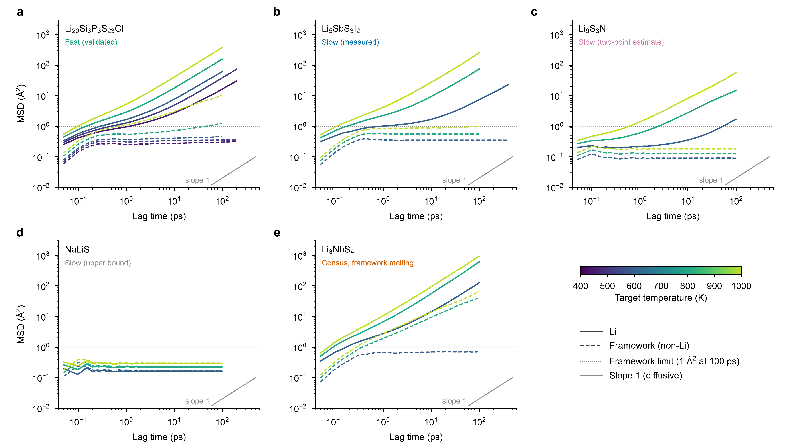

Li MSD (solid) and framework MSD (dashed) against lag time, coloured by target temperature; the dotted line is the 1 A^2 framework limit. **a-d**, One representative per class (the lowest-P1-rank member whose number of eligible temperatures equals the class mode): Li20Si3P3S23Cl (fast), Li5SbS3I2 (slow, measured), Li9S3N (slow, two-point estimate), NaLiS (slow, upper bound). **e**, Li3NbS4 in the seed-0 census, an example of framework melting at 800 and 1000 K. At each temperature the longest trajectory with a full curve is shown (lowest seed on ties). Replicate re-analyses store only 60-100 ps lags, so the leads' seed-0 curves come from their census records. Sources: data/msd_curves.csv.gz, data/runs.csv.

## Extended Data Fig. 2. Atlas of the 62 compositions

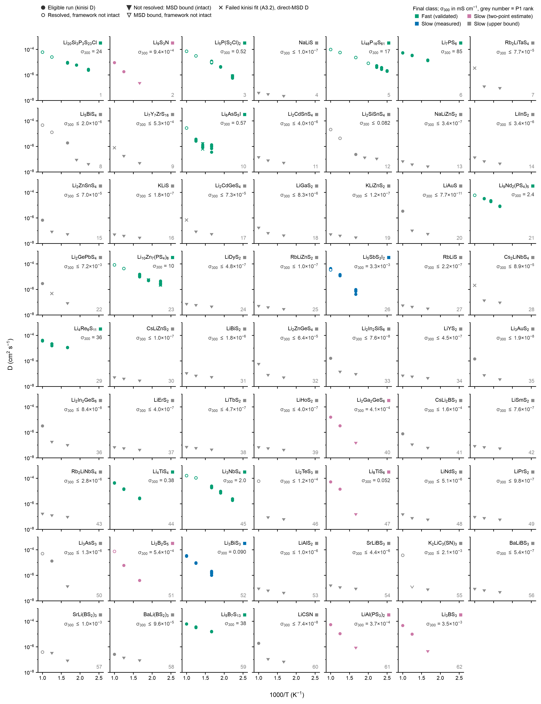

D against 1000/T on shared axes for every record the classifier read, in P1-rank order (grey number). Filled circles, eligible runs; open circles, resolved runs with a framework that is not intact; filled downward carets, MSD bounds D <= MSD(100 ps)/(6 x 100 ps) of non-resolved, framework-intact runs (open caret: non-resolved and not intact); crosses, failed kinisi fits (A3.2) drawn at the direct-MSD D. Colour and the corner square give the final class; the text gives sigma(300 K) in mS cm-1 (<= for bounds). Sources: data/runs.csv, data/classification.csv.

## Extended Data Fig. 3. Seed-0 census flags

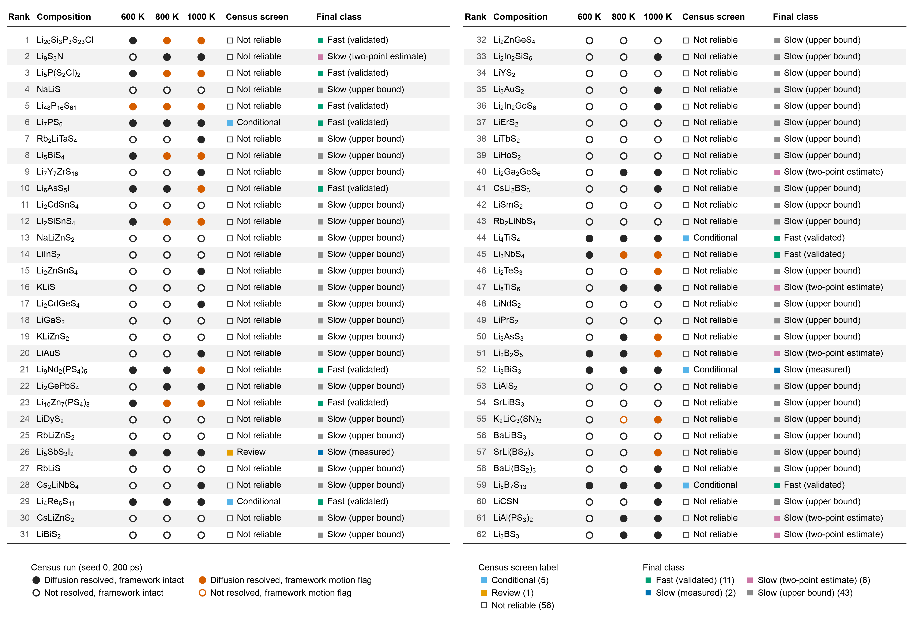

The seed-0 census as evidence: one glyph per composition and census temperature (600, 800, 1000 K; 200 ps). Filled or open shows whether Li diffusion was resolved; black or vermillion shows an intact framework or a framework-motion flag. The census label vetoed a whole composition if any temperature failed (5 conditional, 1 review, 56 not reliable); the final class under the per-temperature protocol is shown beside it. Seven compositions labelled not reliable, mostly because the framework melted at 800 or 1000 K, end fast. Sources: census records of data/runs.csv, data/compositions.csv, data/classification.csv.

## Extended Data Fig. 4. Time-window and covariance sensitivity of the kinisi estimates

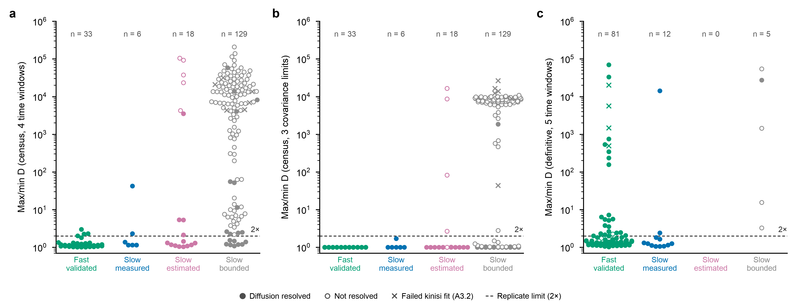

Ratio of the largest to the smallest kinisi D of each record across **a**, four census time windows, **b**, three covariance condition limits (1e6, 1e8, 1e10) and **c**, five definitive time windows, grouped by final class. Filled, resolved; open, not resolved; crosses, failed kinisi fits (A3.2); dashed line, the 2x limit. Non-resolved runs vary by 1e3-1e5 because their kinisi D is near zero; large ratios of resolved definitive runs come from a single sub-window whose fit collapses while the full-window D is unaffected. Sources: data/window_sensitivity.csv, data/runs.csv.

## Extended Data Fig. 5. Framework integrity criteria

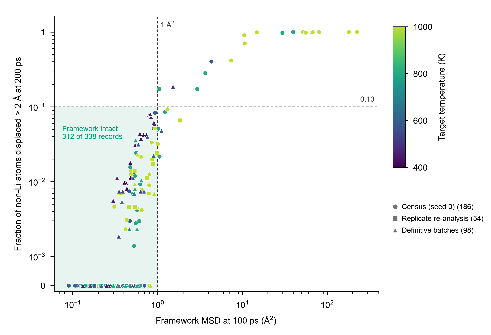

Framework MSD at 100 ps against the fraction of non-Li atoms displaced by more than 2 A at 200 ps for all 338 records (symmetric-log y axis, so records with no displaced atom sit at 0). Dashed lines are the 1 A^2 and 0.10 limits and the shaded box is the intact region; colour is temperature and marker is stage. Every non-intact record exceeds 1 A^2; none fails on the displaced fraction alone. Source: data/runs.csv.

## Extended Data Fig. 6. Temperature control and energy drift

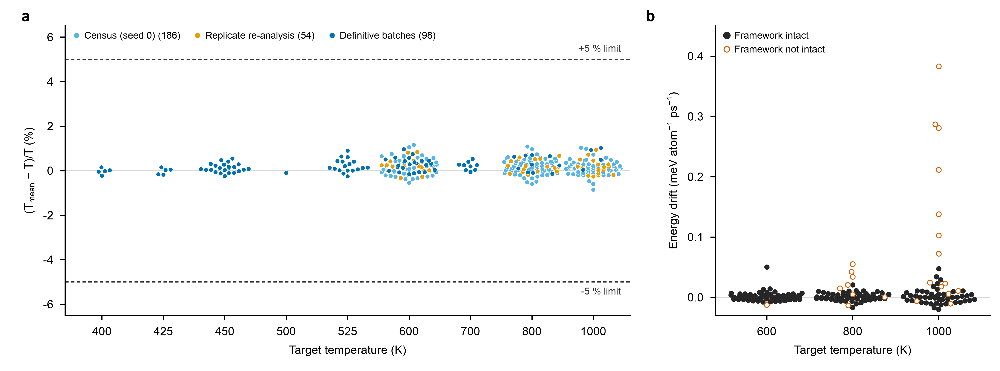

**a**, Relative deviation of the mean temperature from the target for all 338 records, by stage; every record is within 1.2 %, inside the 5 % limit. **b**, Total-energy drift of the 186 census trajectories (recorded for the census only); open vermillion points have a framework that is not intact, and the largest drifts come from melted frameworks at 1000 K. Source: data/runs.csv.

## Extended Data Fig. 7. Per-seed Arrhenius fits of the six census leads

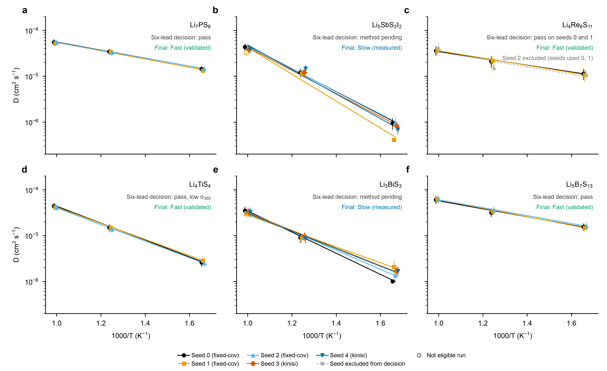

Replicate records of the six census leads (MD seeds 0-2, fixed-covariance estimator over 60-100 ps lags) and the definitive seeds 3 and 4 (kinisi) of Li5SbS3I2 and Li3BiS3. Marker and colour give the seed, open markers are runs that are not eligible and bars are the stored D interval; lines are per-seed OLS fits of ln D on 1/T. Each panel states the six-lead decision and the final class. Li4Re6S11 passed on seeds 0 and 1; its seed 2 is drawn grey and dashed. Sources: data/runs.csv, data/replicates/lead_decisions.csv, data/classification.csv.

## Extended Data Fig. 8. Project 1 screening score against the final class

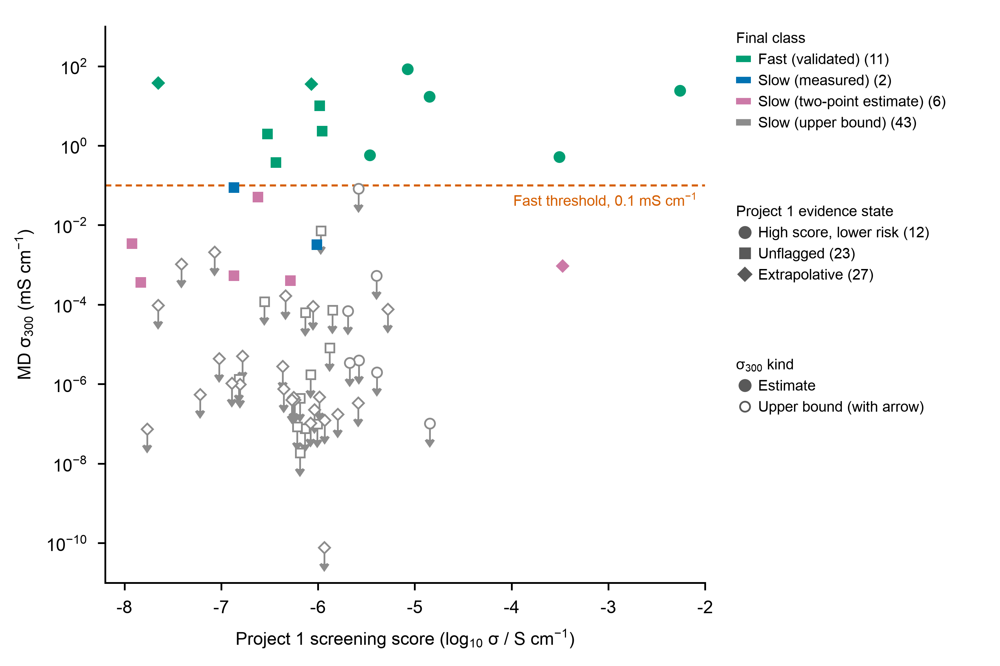

Project 1 screening score (predicted log10 sigma, S cm-1) against the final MD sigma(300 K). Colour is the final class and marker the Project 1 evidence state; filled markers are estimates, open markers with downward arrows are upper bounds; the dashed line is the 0.1 mS cm-1 threshold. Descriptive only: both axes are model predictions. Sources: data/compositions.csv, data/classification.csv.
